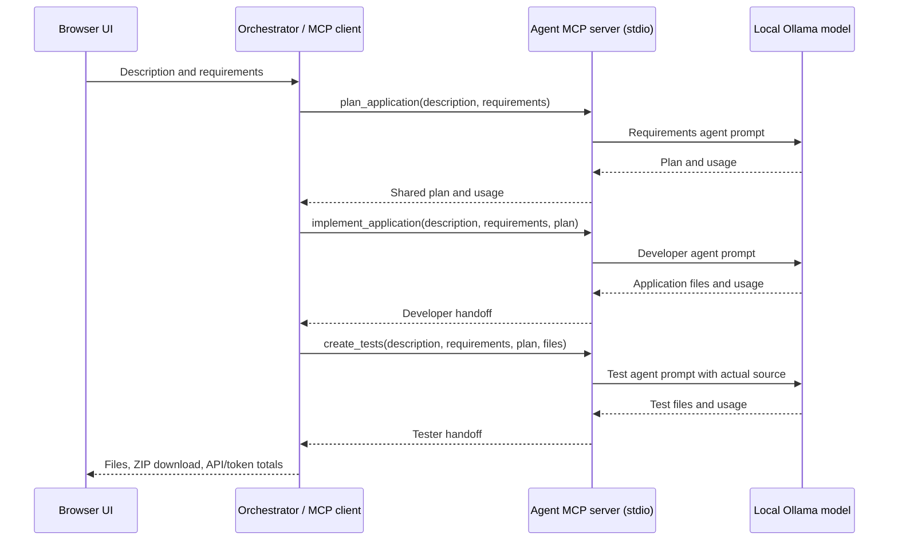

# AI Coder — Medical Symptom Tracker

A local SWE 270P final-project implementation. Enter a software description and requirements in a browser. Three LLM agents collaborate through a real MCP client/server connection to produce a Node.js application and corresponding executable tests. Download the project and see API-call and token totals.

This repository contains the **generator**. The Medical Symptom Tracker is its example input; its application source is generated by your configured model, not returned from a canned tracker template.

## Quick start

1. Install **Node.js 22.9 or newer** and **Ollama** using their official installers.
2. Install a local coding model that fits your machine. The default configuration uses:

   ```sh
   ollama pull qwen2.5-coder:7b
   ```

   You can choose another installed model by setting `OLLAMA_MODEL` in `.env`. The model must support Ollama's structured JSON output.
3. Install project dependencies:

   ```sh
   npm install
   ```

   A `pnpm-lock.yaml` is included for reproducible installation with `pnpm install --frozen-lockfile`.
4. Copy `.env.example` to `.env` and fill in `STUDENT_NAME` and `STUDENT_ID`. In PowerShell:

   ```powershell
   Copy-Item .env.example .env
   ```

5. Make sure Ollama is running. If it is not running through the desktop application, start `ollama serve` in a separate terminal.
6. Start the generator:

   ```sh
   npm start
   ```

   Or, without a package-manager command:

   ```sh
   node --env-file-if-exists=.env src/server.mjs
   ```

7. Open **http://127.0.0.1:3000**. Select **Use tracker example**, review/edit the requirements, and select **Generate application**.
8. Download and extract the completed ZIP. In the extracted project:

   ```sh
   node server.mjs
   ```

   Open http://127.0.0.1:3100. Run the generated tests separately:

   ```sh
   node --test tests/*.test.mjs
   ```

No paid API key is required. The generator makes real requests to Ollama. There is no fake-model mode in the application. Initial model loading and code generation may take several minutes depending on your hardware.

## Required assignment features

| Requirement | Implementation |
| --- | --- |
| Description and requirements UI | `public/index.html`, `public/app.js` |
| Multiple agents with explicit responsibilities | Planner, developer, test writer in `src/agents.mjs` |
| MCP servers, clients, and agent communication | Official MCP SDK; `src/mcp-server.mjs` and `src/orchestrator.mjs` |
| Executable application output | Model-generated Node.js/browser source, file viewer, downloadable ZIP |
| Corresponding executable test cases | Test agent reads the actual developer source and writes `node:test` files |
| LLM API calls and token reporting | Per-agent and per-run accounting; visible UI totals and exported JSON report |
| Defined tracker requirements | `examples/medical-symptom-tracker.json`; editable in the UI |

### Agent collaboration and MCP



The collaboration pattern is a **sequential pipeline with a coordinating host**. The host opens a real MCP stdio connection, negotiates the protocol, discovers the registered tools, and invokes each agent tool. The shared plan travels to the developer, and both the plan and actual generated source travel to the test writer. Each agent has a separate role prompt and uses the configured local model. They share an MCP server process; they do not require separate machines or separate model installations.

| Agent / tool | Inputs | Output / permitted responsibility |
| --- | --- | --- |
| `plan_application` | Description, requirements | Requirements IDs, acceptance criteria, module plan |
| `implement_application` | Original inputs and plan | Complete application source; no test or host-owned files |
| `create_tests` | Original inputs, plan, application files | Only `tests/*.test.mjs` files using actual application interfaces |

The MCP server exposes the three role-specific agent tools. The host chooses their order and forwards their structured results; agents do not independently choose additional tools or perform autonomous agent-to-agent conversations. Agent tooling is limited to model inference and structured-output/file validation. The host handles persistence, syntax checks, and packaging. There is no remote execution, deployment, repair loop, or herder dashboard.

## Configuration

| Variable | Default | Purpose |
| --- | --- | --- |
| `PORT` | `3000` | Local generator port |
| `OLLAMA_BASE_URL` | `http://127.0.0.1:11434` | Ollama endpoint |
| `OLLAMA_MODEL` | `qwen2.5-coder:7b` | Installed model shared by all agents |
| `LLM_TIMEOUT_MS` | `600000` | Timeout for each generation call |
| `LLM_MAX_OUTPUT_TOKENS` | `16000` | Maximum output tokens per call |
| `LLM_CONTEXT_TOKENS` | `32768` | Requested context window; must fit your machine/model |
| `STUDENT_NAME` / `STUDENT_ID` | Clearly marked TODOs | Attribution inserted into generated source |

A normal successful generation makes three LLM API calls. Token totals come directly from Ollama's `prompt_eval_count` and `eval_count`; they are never estimated. Failed attempts count as API calls. If a response does not report tokens, `unreportedCalls` increases and the UI explains that the displayed token total is incomplete. Model-health requests are not LLM inference calls and are excluded.

Runs are saved under ignored `data/`. Refreshing the browser restores its last run. On server restart, unfinished runs are marked interrupted rather than left permanently running. One generation is allowed at a time. The service binds only to loopback and is intended for local classroom use.

## Output contract and verification limits

Generated applications use Node.js built-ins and browser HTML/CSS/JavaScript, with no external dependencies. The host adds `package.json`, README instructions, the requirements/plan, and `generation-report.json`. All generated paths are checked for traversal, duplicate names, and Windows-incompatible paths. Standalone JavaScript files are syntax-checked without executing their contents.

**Generated tests are not automatically executed.** Syntax validity does not establish that all requirements are implemented or that tests pass. Download, inspect, run, and demonstrate your model's actual output. Invalid or truncated model output fails the run with an explanation; there is no canned fallback or automatic repair. A model producing valid JSON can still produce incomplete or incorrect behavior.

Use fictional data in the symptom tracker demo. It is a logging application, not a diagnosis system.

## Repository checks

```sh
npm run check
npm test
```

The tests exercise request validation, safe output paths, syntax checks that never execute generated code, provider accounting, persisted runs, and the full **HTTP UI API → real MCP subprocess → ZIP** flow. Integration tests substitute a deterministic HTTP model fixture, then extract its returned ZIP, launch the generated application, and run its corresponding tests. This verifies the infrastructure without requiring a local model. It does **not** evaluate the quality of a real LLM's generated tracker.

## Before submission

- Replace the clearly marked name/student-ID headers in every source file with the appropriate contributor details. `.env` attribution only affects newly generated files.
- Create/share your GitHub repository with your teammates and the TA. This local implementation does not create a remote repository.
- Review the code and document any attribution/disclosure your course requires. This implementation was created with Codex assistance; adapt and disclose it according to your course policy.
- Run an actual local-model generation and demonstrate the downloaded tracker and its tests.
- See `docs/demo.md` for a short demo/presentation guide.
- Submit the repository ZIP through Canvas and schedule your TA demo. Registration, submission, scheduling, and presenting remain group tasks.

## References

Protocol integration uses the [official MCP TypeScript SDK](https://github.com/modelcontextprotocol/typescript-sdk/tree/v1.x) and its [stdio client documentation](https://ts.sdk.modelcontextprotocol.io/client). Model inference and accounting follow the [official Ollama chat API](https://docs.ollama.com/api/chat). The browser UI, orchestration, prompts, packaging, and tests are project-specific code rather than an adapted open-source application.
